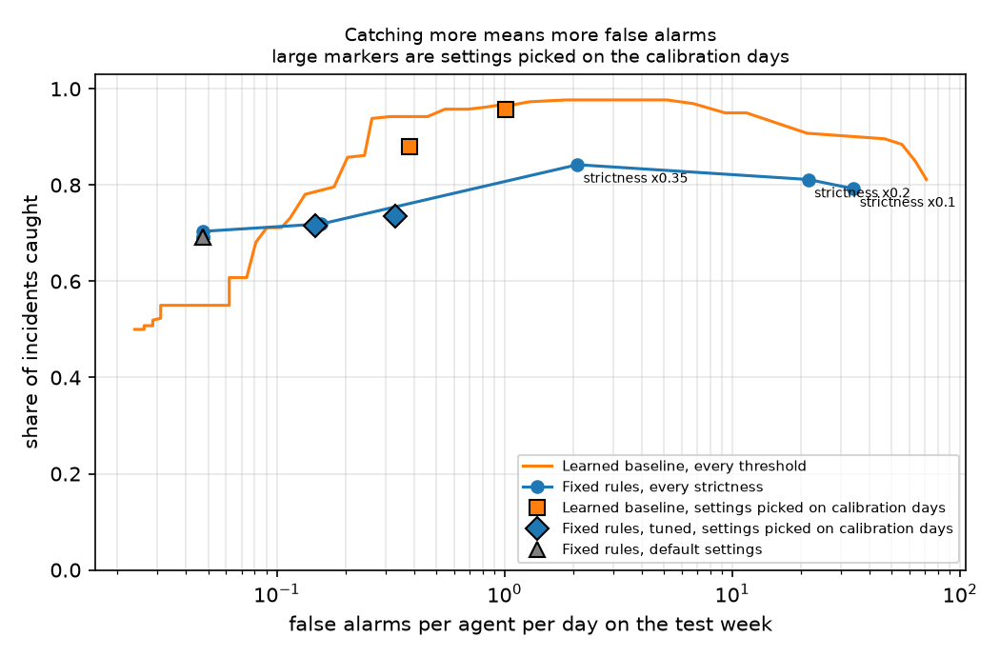
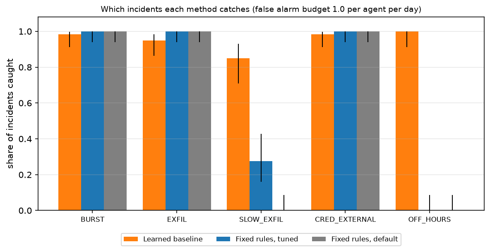
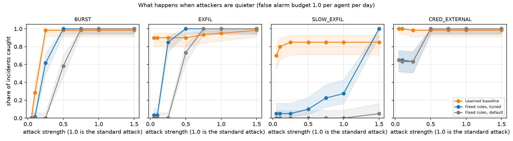
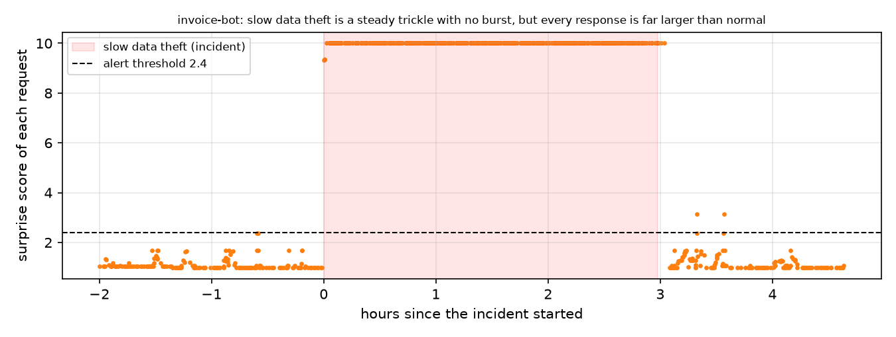

# AgentWatch

A small learning project about monitoring AI agents. If an agent can call APIs, read data and move files on its own, how do you notice when it starts doing something it should not? I built a simulator of agent activity, two kinds of monitors and a way to score them honestly. The question is whether a monitor that learns each agent's own normal behavior can catch things that fixed rules miss, and what that costs in false alarms.

Everything here uses made up data. The incidents are ones I invented, so the results say something about this simulation and the two monitors, not about any real product or real attacker.



## What is in the repo

**Simulator** (`simulate.py`). Six agents, each with its own working hours, request rate, favorite endpoints and the order in which it usually calls them. Fourteen simulated days of traffic are generated. Days 0 to 4 are used to learn normal behavior, days 5 and 6 to pick an alert threshold and days 7 to 13 to test.

**Incidents.** In the test week the simulator adds 26 incidents, each with a known agent, start and end, so a monitor can be scored without guessing.

| Incident | What happens |
| --- | --- |
| BURST | The agent makes dozens of requests in one minute |
| EXFIL | Ten large downloads in five minutes, about 100 MB in total |
| SLOW_EXFIL | A steady trickle of large downloads for three hours, so there is no burst |
| CRED_EXTERNAL | The agent reads credentials, then calls an outside address |
| OFF_HOURS | The agent works at 2 AM, when it never works |

**Benign look-alikes.** Harmless events that look suspicious, so a monitor pays for being jumpy. A weekly batch export, a retry storm from a webhook agent, a maintenance restart by an ops agent and a new endpoint after a tool rollout.

**Fixed rules** (`rules.py`). The way a simple monitor is usually first built. Alert on more than 20 requests in 60 seconds, more than 50 MB in 5 minutes, the first touch of a sensitive path, or a successful credentials call followed by an outside call within 2 minutes. I also sweep how strict the rate and volume limits are.

**Learned baseline** (`baseline.py`). For each agent it learns five things from clean history. How many requests it makes per minute and how much that varies from day to day, how many bytes it moves in five minutes, which hours it is active, which endpoints it uses and which endpoint usually follows which. Each new request gets five surprise scores, one for each. A score of 3 means about 1 chance in 1,000 under that agent's own history. The request is scored by its biggest surprise, and an alert fires when that passes a threshold. The scores are a simple combination, not calibrated probabilities.

**Evaluation** (`evaluate.py`, `run.py`). An incident counts as caught if an alert for that agent lands between its start and five minutes after its end. Any other alert is a false alarm. After an alert, further alerts for the same agent are ignored for 10 minutes. The learned baseline's threshold and the rules' strictness are both chosen on the calibration days, using a budget of false alarms per agent per day, so neither method gets to peek at the test week.

## Results

Ten simulated runs, 260 incidents in total. Ranges are 95 percent Wilson intervals on the pooled counts. Incidents within a run share agents and days, so the ranges are a little optimistic.

With a budget of 1 false alarm per agent per day on the calibration days.

| Method | BURST | EXFIL | SLOW_EXFIL | CRED_EXTERNAL | OFF_HOURS | All incidents | False alarms per agent per day |
| --- | --- | --- | --- | --- | --- | --- | --- |
| Learned baseline | 98% | 95% | 85% | 98% | 100% | 96% (93% to 98%) | 1.02 |
| Fixed rules, tuned | 100% | 100% | 28% | 100% | 0% | 73% (68% to 78%) | 0.33 |
| Fixed rules, default | 100% | 100% | 0% | 100% | 0% | 69% (63% to 75%) | 0.05 |

With a tighter budget of 0.25 per agent per day, the baseline catches 88% of incidents at 0.38 false alarms per agent per day, tuned rules catch 72% at 0.15, and default rules catch 69% at 0.05. Full tables are in `results/summary.md`.



What I take from it.

1. **Rules are excellent against loud attacks.** Bursts, big downloads and the credentials then outside call are caught every time by the default rules, with almost no false alarms. The learned baseline is slightly worse on these, 95 to 98 percent.
2. **Rules are blind to quiet attacks.** They never see the agent working at 2 AM, and they miss the slow trickle because each five minute window stays under the limit. The baseline catches all of the off hours incidents and 85 percent of the slow thefts, because it compares each agent with its own history, not with one number for everyone.
3. **The price is false alarms.** The default rules raise about 0.05 false alarms per agent per day. The baseline needs about 1.0 to reach 96 percent, around 20 times as many, which is roughly six alerts a day across this six agent fleet. Whether that is acceptable depends on who has to read them.
4. **The calibration days underestimate test week false alarms.** At a budget of 0.25 the baseline actually produced 0.38, because the benign look-alikes never appeared in the calibration days. Between 8 and 19 percent of its false alarms came from those look-alikes. The rest are ordinary statistical noise in the tails.

### What happens when attackers are quieter

I repeated the experiment while scaling the strength of every attack, where 1.0 is the standard attack above.



Both methods fail once the attack looks like the agent's own noise, but at different points. At strength 0.05 a burst is two requests in a minute and nobody catches it. At 0.1 it is four requests and the baseline catches 28 percent. At 0.25 it is ten requests and the baseline catches 98 percent, while the default rules catch none until the burst passes 20 requests. A tuned rule can catch moderately large downloads as well as the baseline, and at the strongest slow theft it catches them all, but it pays for that in false alarms, as the trade off plot shows. For the credentials then outside call, the rules fall to 63 percent once the attacker waits longer than their two minute window, while the baseline still sees the credentials access itself.



### Where the baseline misses

At the 1 per day budget it missed 11 of 260 incidents. Eight of them were thefts from the report agent, which legitimately moves large files, so stolen data blends in with its normal volume. The other three had very high scores but were hidden because a false alarm for the same agent had fired in the 10 minutes before, and my alert quiet period dropped the real one. Letting much higher scores through the quiet period would fix that.

## Assumptions and limitations

1. Everything is simulated. The agents, their habits and the incidents are my own inventions. Results depend on those choices, and I picked incident types that show where each method is strong or weak.
2. The baseline learns from clean history. If an attacker is already active during the learning period, it learns the attack as normal. I have not tested that.
3. The baseline never updates, so a legitimate change in an agent's behavior, like a new tool, keeps raising alerts. Real systems need a way to adapt.
4. A new agent has no history, so the baseline cannot say anything about it.
5. The attackers do not adapt. A real one who knows the thresholds could stay just under them.
6. The detectors are simple. The surprise scores use a negative binomial for request counts and a normal curve for log volume, which fits this simulated data but may not fit real traffic.
7. I rewrote the rules in vectorized form for speed. They give the same alerts as an independent, slower implementation on two full simulated runs.

## How to run

```
pip install -r requirements.txt
python run.py                # about a minute, writes tables and figures to results/
python run.py --seeds 30     # tighter ranges
pytest
```

`results/sample_logs.jsonl` is one hour of the simulated log in a readable form.

## Next steps

Let the baseline update as it goes and test how fast it adapts to a legitimate change. Test what happens when the training period is already poisoned. Add cumulative volume over hours, which should help with the slow thefts that hide inside heavy agents. Replace the quiet period with escalation so a much higher score is never hidden. Try the same comparison on real, anonymized logs.
