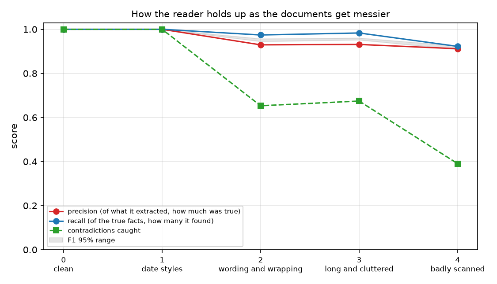
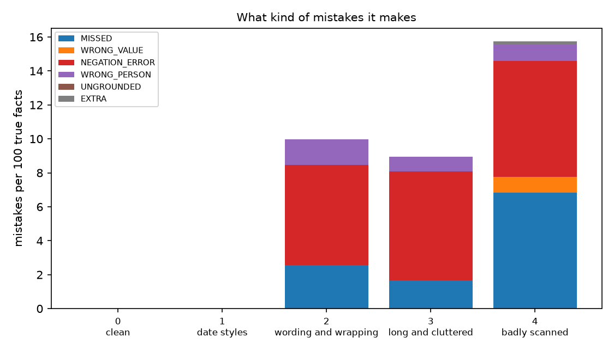

# CaseCheck

A test bench for software that reads case files. Law firms and insurers are starting to use AI to pull facts out of depositions and medical records. A wrong reading is expensive, for example a diagnosis that was ruled out gets listed as real, or a plaintiff's denial that contradicts the records goes unnoticed. This project asks how you would know whether such a reader can be trusted.

It invents case files with an exact answer key, lets any extractor read them, and checks every fact it returns. The messiness of the documents can be turned up in five steps, so you can see where a reader starts to fail and what kind of mistakes it makes. All of the people and records are made up.



## What is in the repo

**Case generator** (`generate.py`). Each case is one invented plaintiff with two documents. A medical record summary with several visits, and a short deposition transcript where the plaintiff answers questions about the accident. Because the documents are generated from facts, the answer key is exact. The facts are the accident date, each visit with its provider, each diagnosis and medication by visit, earlier conditions of the plaintiff and what the plaintiff said under oath.

**Traps.** Statements a careless reader mistakes for facts.

| Trap | Example in the document | Mistake it causes |
| --- | --- | --- |
| Ruled out | "fracture ruled out" | A fracture is listed as a diagnosis |
| Denied | "patient denies prior neck problems" | A prior neck condition is listed |
| Wrong person | "family history of lower back pain (mother)" | A prior condition is listed for the plaintiff |

**Planted contradictions.** In some cases the plaintiff says under oath that they never had problems with a body part that the records show they did, or gives an accident date that does not match the records. A good reader should catch both.

**Messiness levels.**

| Level | What changes |
| --- | --- |
| 0 | Clean text with one date style |
| 1 | Four different date styles |
| 2 | Abbreviations, varied wording for traps, hard wrapped lines, five visits |
| 3 | Eight visits, page headers and billing clutter, two digit years |
| 4 | Badly scanned text, so some characters are misread |

**Extractors.** Anything that turns a document into a list of facts can be scored. Each fact carries a quote copied from the document. Two are included. `extract_rules.py` is a careful rule based reader, the kind you would write before reaching for a language model. `extract_llm.py` asks a language model running on your own computer through Ollama, so no document leaves the machine.

**Scoring** (`score.py`). Every fact is compared with the answer key, and every mistake gets a name.

| Mistake | Meaning |
| --- | --- |
| MISSED | A true fact was not found |
| WRONG_VALUE | The right kind of fact with a wrong value, such as a wrong date |
| NEGATION_ERROR | Something denied or ruled out was extracted as true |
| WRONG_PERSON | Something about a relative was extracted as the plaintiff's own |
| UNGROUNDED | The supporting quote is not in the document |
| EXTRA | A real quote, but the fact is not in the answer key |

The scorer also reports how often the quote can be found in the document, and checks whether the reader noticed the planted contradictions, using only the facts it extracted.

## Results for the rule based reader

100 cases per level, 500 cases in total, and about 11,000 true facts. The reader was written by looking at the same document templates the generator uses, so a perfect score on the clean levels is expected. What matters is how it breaks.

| Messiness level | Precision | Recall | F1 (95% range) | Quotes found in document | Contradictions caught |
| --- | --- | --- | --- | --- | --- |
| 0 clean | 1.000 | 1.000 | 1.000 | 100% | 100% |
| 1 date styles | 1.000 | 1.000 | 1.000 | 100% | 100% |
| 2 wording and wrapping | 0.929 | 0.974 | 0.951 (0.945 to 0.957) | 100% | 65% |
| 3 long and cluttered | 0.931 | 0.983 | 0.957 (0.952 to 0.961) | 100% | 67% |
| 4 badly scanned | 0.912 | 0.922 | 0.917 (0.909 to 0.925) | 100% | 39% |



What I take from it.

1. **The average hides the facts that matter.** The overall score stays between 0.92 and 0.96 from level 2 onward, which looks fine. But the reader catches only 65 percent of the contradictions at level 2 and 39 percent at level 4. The facts needed to spot a contradiction, earlier conditions and "I never had problems", are exactly the ones that are worded in many ways. Their recall is 0.56 to 0.77, while dates, visits, diagnoses and medications stay near 1.00 until the text is badly scanned. A single headline number would have shown none of this.
2. **Its main error is trusting wording it was never told about.** About 6 in every 100 true facts come back as a negation error. The reader knows "ruled out", "no evidence of" and "negative for", so it is fooled by "was excluded" and lists a ruled out fracture as a diagnosis. It also treats a statement about the plaintiff's sister as the plaintiff's own, because it only knows the words mother, father and family history.
3. **Misses come from phrasing, not from dates.** "Hx of neck pain" and "Nothing like that" are not in its patterns, so those facts are never found. Date formats alone did not hurt it at level 1.
4. **Bad scans hurt differently.** At level 4 recall drops to 0.92 and wrong values appear, because a misread digit turns a real date into a different date.
5. **It never invents contradictions.** None of the contradictions it flagged were false. It only missed real ones. That is the safer way to fail, but a missed contradiction is still a missed contradiction.
6. **Every quote was found in the document.** That is true by construction for a rule based reader, which cannot make up text. The number matters for language models, which can.

`results/example.md` shows one level 2 case in full, with the documents and the exact mistakes the reader made.

## Try it with a language model on your own computer

```
ollama pull mistral
python run.py --extractor ollama --model mistral --levels 0 2 4 --cases 10 --out results/mistral
```

Nothing leaves your machine. Language models make a different kind of mistake from rules, so the interesting numbers are the share of quotes found in the document and the number of UNGROUNDED and NEGATION_ERROR mistakes. The model, the prompt and the chunk size all change the results. The reader that talks to Ollama is tested here for its parsing and chunking with a stand in model. The results above are for the rule based reader only.

## Limitations

1. The documents are generated from templates, and real depositions and records are far messier. The rule based reader was written looking at these templates, so its good scores on the clean levels say little.
2. Only three kinds of trap and two kinds of contradiction are tested. Treatment gaps, conflicting dosages and statements that change over time are not covered.
3. Scoring is strict. A fact counts only if every field matches the answer key exactly, so a correct diagnosis written with a synonym counts as a mistake.
4. The answer key only holds simple facts. It does not test summaries, reasoning or long range links between documents.
5. All text is English with one layout. Tables, handwriting and scanned page images are not included. Level 4 imitates bad scanning only by swapping some characters.
6. With 100 cases per level the ranges are narrow, but they only describe this generator.

## How to run

```
pip install -r requirements.txt
python run.py                # about 10 seconds, writes tables and figures to results/
pytest
```

## Next steps

Run several local language models through the bench and compare them with the rule based reader. Add more kinds of contradiction. Ask readers to say when they are unsure, and measure whether those admissions line up with their actual mistakes. Try the same bench on real, redacted documents.
