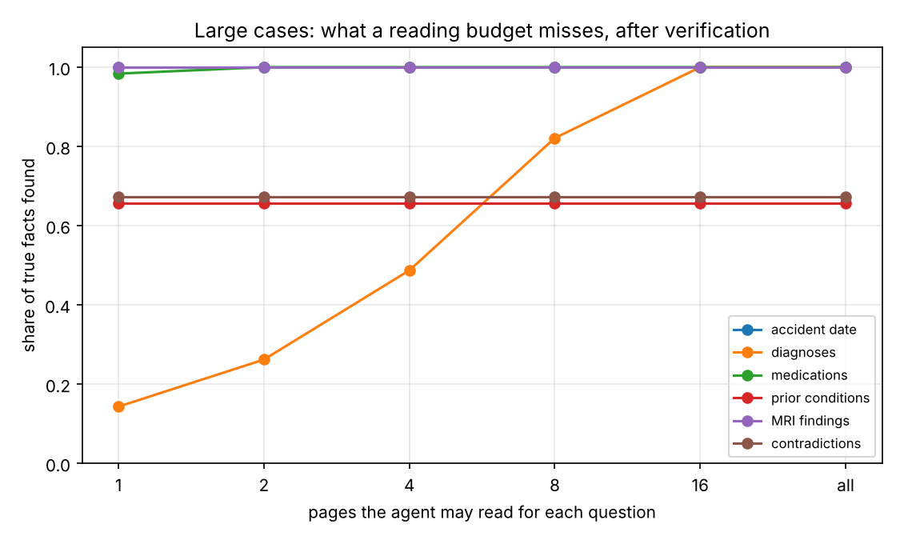
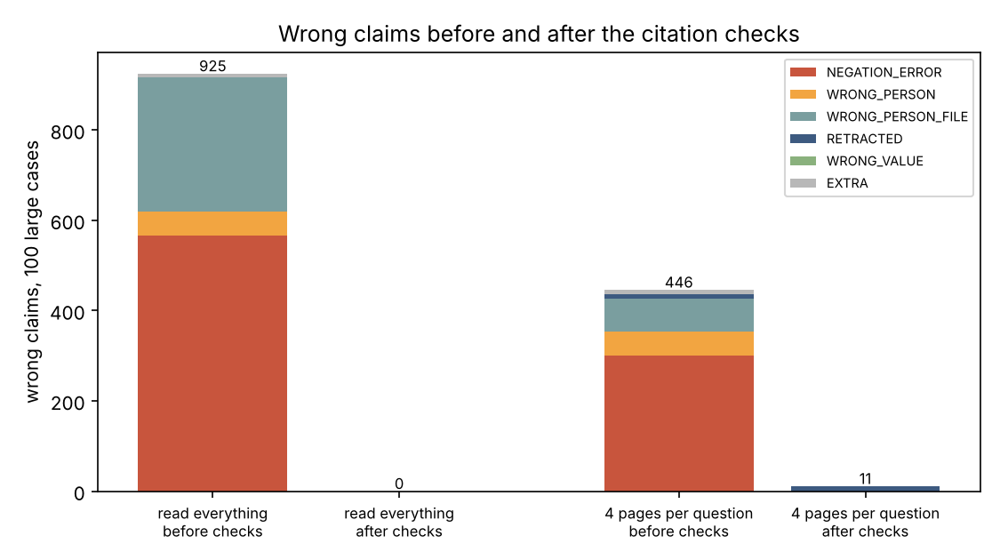

# CaseTrail

An agent that answers questions about a folder of case files, where every claim must quote the page it came from, every quote is checked in code before an answer is shown, and the test counts the facts it missed, not only the ones it got wrong.

Most question answering demos report how often an answer is wrong. For legal and medical files, the more dangerous failure is often silent. The agent never opened the page with the second MRI, or it cited a record that belongs to a different patient with the same name. CaseTrail measures both. It builds on [CaseCheck](../casecheck), which tested one document at a time. Here the files are many and the agent has to decide where to look. All of the people and records are made up.



## How it works

```
case folder ──> navigation map ──> agent ──> claims with quotes ──> checks in code ──> score against the answer key
 (many files)    (where things     (search,    (file, page,          (quote on page?      (found, missed,
                  are, never        open page,  exact quote)          right patient?       wrong, cited
                  cited)            finish)                           supported?)          on the right page?)
```

**Case folders** (`generate.py`). Each case is one invented plaintiff with a folder of files in a shuffled order, the way a legal production arrives. There is an emergency record, clinic notes, therapy notes, a radiology report in most cases, a pharmacy record, billing statements and a deposition. Large cases add a duplicate copy of one file and a record of a different person with the same name. Every page has a header with the patient's name, date of birth and record number, and pages never split a visit or a question and its answer. The answer key lists every fact and every page where it appears.

| Size | Files per case | Pages per case | True facts per case |
| --- | --- | --- | --- |
| Small | about 7 | about 7 | about 11 |
| Large | about 17 | about 31 | about 53 |

**Traps**, statements a careless reader takes as facts.

| Trap | Example | Mistake it causes |
| --- | --- | --- |
| Negation | "fracture was excluded", "patient denies prior neck problems" | Something ruled out is listed as real |
| Relative | "patient's sister had a prior neck injury" | A relative's condition is listed as the plaintiff's |
| Other patient | a record for a different person with the same name | Their diagnoses are listed as the plaintiff's |
| Retraction | a later file says a diagnosis "was entered in error" | A withdrawn diagnosis is still listed |

**The navigation map** (`navmap.py`). An index built once from the files, with each file's type, patient and page sections, and a word index of what appears on which page. The agent uses it only to decide where to read. Nothing is ever cited from the map. Every citation comes from the page text.

**Tools** (`tools.py`). `list_files`, `search_map` and `open_page`. Every page opened is counted, so the cost of an answer is measured.

**Agents** (`agents.py`, `llm_agent.py`).

| Agent | How it works |
| --- | --- |
| Fixed workflow | For each question, set searches on the map, read the top pages up to a page budget, and extract facts with a rule based reader |
| Read everything | Read every page once, keep a table of facts with their pages, and answer every question from it |
| Language model, agent mode | A local model picks one tool at a time, with a step limit and a page budget, and finishes with claims that cite their sources. Runs through Ollama, so nothing leaves the machine |
| Language model, guided mode | The fixed workflow picks the pages, and the model only reads them |

**Checks in code** (`verify.py`). Every citation is checked before a claim is kept. Is the quote really on that page? Does the page belong to the plaintiff, by date of birth and record number? Does the quote state the fact, without a negation or a relative? A contradiction needs a surviving citation on both sides. The checks never see the answer key.

**Scoring** (`score.py`). A claim counts as found only if its fact is true and at least one citation points to a page where that fact really appears. Otherwise every mistake gets a name, such as MISSED, WRONG_CITATION, NEGATION_ERROR, WRONG_PERSON, WRONG_PERSON_FILE, RETRACTED or EXTRA.

There are six questions per case. They ask for the accident date, every diagnosis, every medication, prior conditions, the MRI findings, and where the deposition contradicts the records.

## Results for the rule based agents

100 small and 100 large cases. The rule based reader was written knowing the document templates, so its perfect scores on clean phrasing are expected. What matters is where answers break.

**Large cases, after the checks.** The page budget is per question.

| Agent | Share of true facts found (95% range) | Precision | Pages read per case |
| --- | --- | --- | --- |
| Workflow, 1 page | 0.476 (0.461 to 0.491) | 0.997 | 4.7 |
| Workflow, 2 pages | 0.552 (0.538 to 0.567) | 0.996 | 7.5 |
| Workflow, 4 pages | 0.686 (0.673 to 0.700) | 0.997 | 10.2 |
| Workflow, 8 pages | 0.885 (0.878 to 0.893) | 0.998 | 13.8 |
| Workflow, 16 pages | 0.992 (0.989 to 0.995) | 1.000 | 14.9 |
| Read everything | 0.992 (0.989 to 0.995) | 1.000 | 31.4 |

In small cases, two pages per question already find every fact.



What I take from it.

1. **High precision can hide low coverage.** With four pages per question, almost every claim the agent makes is correct, 0.997, yet it finds only 69 percent of the true facts. A test that counted only wrong answers would call it excellent. Missed facts have to be measured on purpose, with an answer key that knows where every fact is.
2. **Questions differ in how much reading they need.** The accident date, the MRI and the medications are nearly complete after one page, because one page or the pharmacy record holds them. Diagnoses are spread across many visits and files, so one page finds 14 percent of them, eight pages 82 percent and sixteen pages all of them.
3. **The map halves the reading at no cost.** A workflow guided by the map reaches the same 0.992 as reading everything, while opening about 15 pages per case instead of 31, because it skips therapy notes and billing.
4. **More reading does not fix weak reading.** Prior conditions and contradictions stay near 66 percent at every budget, even when reading everything. The misses come from phrasings the reader does not know, such as "Hx of neck pain" and "Nothing like that". The overall 0.992 hides this, since there are far fewer of these facts. Every claim it did make on those questions was correct, so it fails by missing, not by inventing.
5. **Reading more also meets more traps.** Before the checks, precision falls from 0.948 at one page to 0.850 when reading everything, mostly from negations and the other patient's record.
6. **The checks remove every quote level error, but not every error.** When reading everything, the checks removed all 925 wrong claims. With four pages per question, 11 withdrawn diagnoses remained, because their correction was on a page the agent never read. A check that looks only at one quote cannot know about a page elsewhere in the case.

## A language model on your own computer

Two modes, so the two halves of the job can be tested separately.

| Mode | Who chooses the pages | Who reads them |
| --- | --- | --- |
| `agent` | the model, one tool call at a time | the model |
| `guided` | the fixed workflow, the same pages the rule based agent reads | the model, in one call per question, and code compares testimony with records |

Two options for the agent, to measure each change on its own. `--citations lines` shows pages with numbered lines and lets the model cite line numbers, so the code fills in the exact text, while `--citations quotes` makes it copy words itself. `--nudges 1` tells the model once if it tries to finish while pages from its own searches are still unread, and `--nudges 0` turns that off.

```
ollama pull qwen2.5:7b
python run.py --agent ollama --mode agent  --model qwen2.5:7b --size large --cases 5 --budget 8
python run.py --agent ollama --mode guided --model qwen2.5:7b --size large --cases 5 --budget 8
python run.py --agent ollama --mode agent  --citations quotes --nudges 0 --model qwen2.5:7b --size large --cases 5 --budget 8
```

Start with `--cases 1` to time one case. Each case is answered once and scored before and after the checks. The run writes a results file with the scores and a log of steps, pages, unreadable replies and nudges for every question. The agent asks Ollama for a 16,384 token context window, because a shorter window silently drops the oldest messages, including the instructions. Lower it with `--num-ctx 8192` if memory runs short.

### First run with a real model

Qwen 2.5 7B on an Apple M4 with 16 GB, 5 large cases, 8 pages per question, in the first version of the agent, which copied quotes itself and had no nudge.

| Result | Value |
| --- | --- |
| Share of true facts found, after the checks | 0.049 (0.02 to 0.08) |
| Precision before and after the checks | 0.31 and 0.78 |
| Pages read per case, all six questions | 6, about one per question, out of 48 allowed |
| Citations removed by the checks | 23 that did not support the claim, 6 not on the page, 2 on pages that do not exist |
| Malformed replies | 32, about one per question, each retried |
| Time | 23.7 minutes |

The model finished every question on its own, without hitting the step limit, but after reading about one page. It also listed ruled out items as diagnoses 20 times, which the checks removed. With the same budget, the rule based workflow read about 14 pages per case and found 0.885. So the first problem was not reading, it was stopping too early, which a test that only counts wrong answers would never show. Line citations, the nudge and guided mode were added to measure what each fixes. Five cases is a small sample, and the prompt changed slightly after this run.

## Is it correct?

`pytest` runs 22 tests. They check that every true fact really is on every page the answer key names, that pages never split a visit, that traps never overlap true facts, the map, the page budget, the agents, the checks, the scorer's mistake names and the language model loop with a scripted model. I also broke the code on purpose in three ways, a verifier that skips the patient check, retractions that are ignored and a page budget that is not enforced. The tests caught each one.

## Limits

1. **The data is invented and regular.** Real files have far more variety, scans and handwriting. The generator varies wording on purpose, but the phrasings are still finite.
2. **The checks know the generator's wording.** Their negation and relative words were written knowing the templates, so they are close to the best a check could do here. On real files, a support check would be a separate model that sees only the claim and its quote, and it would miss more.
3. **The rule based reader also knows the templates.** Its perfect scores on clean phrasing say little. Its failures are the useful part.
4. **Page budgets are per question,** and the cost counted is pages read. Real costs also include tokens, model calls and time.
5. **Six fixed questions.** Open questions, follow ups and judgment calls are not tested.
6. **Only one small real model run so far,** 5 cases with one model.

## Run it

```
pip install -r requirements.txt
python run.py          # writes results/results.json, results/summary.md and the charts
pytest
```
