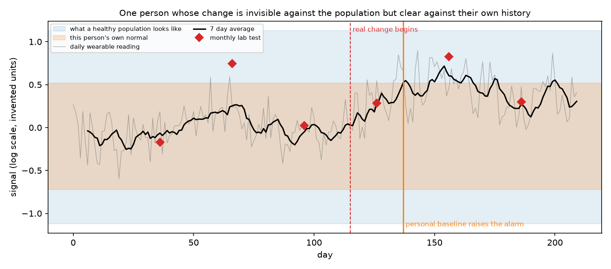
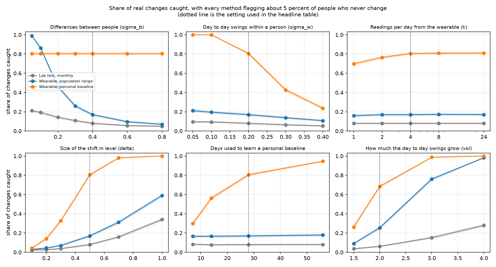

# Personal Baseline

A small simulation about one question. Some signals, such as a hormone level, differ a lot from person to person and also swing from day to day. A lab test takes one reading now and then and compares it with the range for a healthy population. A wearable can take readings all day and learn what is normal for one person. When does that second approach catch real changes that the first one misses, how quickly and how much data does it need?

Everything here is simulated. The signal is an invented number on a log scale, not any real hormone, and the settings are not measurements of any condition or any device. The project tests a statistical idea. It is not medical advice and it says nothing about how any product performs.



## How it works

**The signal** (`sim.py`). Each person has their own usual level, and people differ from each other by `sigma_b`. Around that level the signal wanders from day to day by `sigma_w`, and today resembles yesterday. Every reading also has measurement noise `sigma_m`. A wearable that reads `k` times a day averages that noise down. All numbers are on a log scale, so +0.5 means about 65 percent higher.

**Two kinds of change.** Starting on a random day between day 60 and day 120, either the person's level rises over 14 days, or their day to day swings grow bigger. A change counts as caught if an alarm comes within 60 days of it starting.

**Three ways to notice** (`methods.py`).

| Method | What it does |
| --- | --- |
| Lab test, monthly | One reading a month, compared with the range of a healthy population |
| Wearable, population range | The 7 day average of daily readings, compared with the same population range |
| Wearable, personal baseline | The 7 day average compared with the person's own first 28 days |

**A fair comparison** (`experiments.py`). Alarm thresholds are set on simulated people who never change, so that every method flags about 5 percent of them by mistake over roughly six months. That was checked on fresh people. The methods flagged between 4.2 and 5.0 percent of them in the headline runs. Each method is then judged on how many real changes it catches at that same cost in false alarms. Each scenario uses 4,000 people.

## Results

A rise in level of +0.5, using the default settings (people differ by 0.4, day to day swings of 0.2, measurement noise of 0.25 per reading, four readings a day, 28 days to learn a baseline).

| Method | Changes caught within 60 days | Median days to catch | Never changed, flagged by mistake |
| --- | --- | --- | --- |
| Lab test, monthly | 8% (7% to 9%) | 28 | 4.2% |
| Wearable, population range | 17% (16% to 18%) | 21 | 4.8% |
| Wearable, personal baseline | 80% (79% to 82%) | 20 | 4.7% |

When the day to day swings double, the personal baseline catches 68 percent, the population range 25 percent and the monthly lab test 6 percent. Full tables are in `results/summary.md` and `results/sweeps.md`. Repeating the headline with three other random seeds gave 79 to 82 percent for the personal baseline.



What I take from it.

1. **A real change can hide inside the normal range.** The figure at the top shows a person whose level rose clearly, but their 7 day average and every lab test stayed inside what a healthy population looks like, because people differ so much from each other. Only the comparison with their own history raises the alarm. The monthly lab test is weakest of all. It takes one noisy reading a month and it also compares against the population.
2. **The personal baseline is not always better.** When people are nearly identical (differences of 0.05 or 0.1), the population range catches 99 and 86 percent, against 80 percent for the personal baseline. The population range is learned from thousands of people, while a personal baseline comes from 28 noisy days of one person. In this setup the two cross somewhere between differences of 0.1 and 0.2. The personal baseline is worth it when people differ a lot from each other.
3. **Learning time matters a lot.** With 7 days of history the personal baseline catches 30 percent, with 14 days 56 percent, with 28 days 80 percent and with 56 days 95 percent. A new user would get much weaker detection at first. Starting from a population range and moving toward the personal baseline is an obvious idea that I did not test.
4. **Day to day swings are the limit.** The personal baseline catches everything when swings are small (0.05 to 0.1), but only 43 percent at 0.3 and 24 percent at 0.4. If a person's own signal is erratic, a shift has to be larger or you need to wait longer. No method gets around that.
5. **More readings per day stop helping quickly.** One reading a day catches 70 percent, four a day 80 percent and 24 a day 81 percent. After a few readings are averaged, the noise left over is the person's real day to day swing, which no sensor can average away. This only holds when the sensor noise is not the main problem, and I only tested one noise level.
6. **A single snapshot cannot see how erratic someone is.** When the swings double, a monthly lab test catches 6 percent and the personal baseline 68 percent. When they triple, the lab test catches 15 percent and the personal baseline 99 percent.
7. **Speed.** The personal baseline's median time to catch was 20 days, against 28 for the monthly lab test. The monthly test cannot do better than its spacing, and the shift itself takes 14 days to build up in this setup.

## Limitations

1. The signal, its numbers and the way it changes are invented. Real hormones have daily rhythms, cycles and spikes that this does not model.
2. Sensor drift, wearing the device wrong and missing data are not modeled. All measurement noise is independent.
3. The change always starts from a stable baseline period with no change in it. Real changes can be slow, intermittent or already underway.
4. The personal baseline is as simple as possible, an average and a spread over 28 days, and the alarm is a 7 day average past a threshold. A better method would do better.
5. The threshold of 5 percent false alarms over about six months is a choice. A stricter one lowers every method's detection. A real product would also care about false alarms per person per month and about how a person reacts to an alarm.
6. The healthy population is assumed to exist and to be large. For a condition where many people are in transition, that is not obvious.
7. The effect sizes are arbitrary. The conclusions are about the shape of the tradeoffs, not about how large any of the numbers would be in practice.

## How to run

```
pip install -r requirements.txt
python run.py            # about a minute, writes tables and figures to results/
pytest
```

## Next steps

Blend a population prior with the personal baseline for new users and test how fast it learns. Add daily rhythms, a cycle and sensor drift. Replace the invented signal with a real public wearable time series. Judge the methods by false alarms per person per month.
