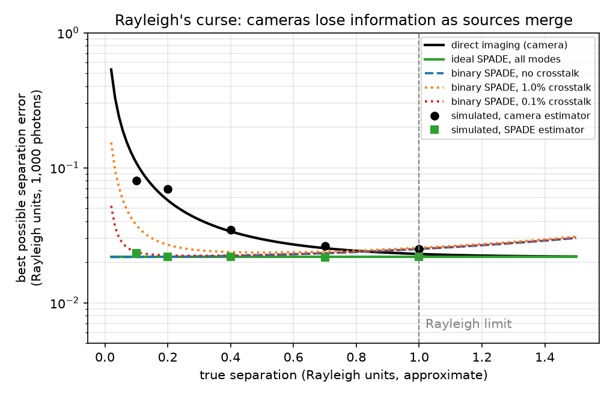

# Resolving Point Sources Below the Rayleigh Limit with a CNN

A small learning project. I wanted to understand the problem behind sub diffraction imaging, so I built a simplified version of it. Can a CNN tell whether a blurry spot is one point source or two, and estimate how far apart they are, even when the separation is below the Rayleigh limit?


## The problem

Every lens blurs a point of light into an Airy pattern. The Rayleigh criterion says two equally bright points are "just resolved" when the center of one sits on the first dark ring of the other. Below that separation, the eye and simple methods see a single blob.

The Rayleigh criterion is a rule of thumb, not a hard law. With a good model of the optics and enough photons, statistics can still pull information out of the blob. The real limit comes from photon noise.

## What this repo does

**Simulator** (`psf.py`). Renders images of one or two incoherent point sources through a circular aperture. It uses the Airy point spread function, integrates light over each pixel, adds background and applies Poisson shot noise. Sources have random position jitter and random orientation.

**Classical baseline** (`baseline_glrt.py`). For each image, fits a one source model and a two source model by Poisson maximum likelihood, then uses the likelihood ratio to decide one vs two. The two source fit also gives a separation estimate. This is the standard approach and the fair bar for the CNN to meet.

**Theoretical limit**. Computes the classical Cramer Rao bound on separation from the Fisher information of the pixel data. No unbiased estimator using direct imaging can beat this curve.

**CNN** (`model.py`, `train.py`). A small convolutional network with two heads, one for one vs two sources and one for separation. Trained on simulated data with flip and rotation augmentation.

## Results

Settings are a 32 by 32 pixel image, Rayleigh radius of 5 pixels, 1,000 signal photons and 2 background photons per pixel. The CNN trained for 15 epochs on 60,000 simulated images and was tested on 10,000 new ones.

**Detection.** The CNN reached 92.7% test accuracy on the one vs two task. Both methods detect two sources essentially every time from about 0.4 Rayleigh units upward, well below the Rayleigh limit. At its default threshold the CNN is more conservative, with a 2% false alarm rate against 7% for the likelihood ratio test, so it misses more close pairs. Set to the same 7% false alarm rate, the CNN matches the classical method almost exactly (19% vs 20% detection near 0.12, and 75% vs 78% near 0.27). The area under the ROC curve is 0.959 for the CNN and 0.964 for the classical test.


**Separation.** From about 0.4 Rayleigh units upward, the CNN's error sits within roughly 10 to 20% of the Cramer Rao bound, the best any unbiased method can do with direct imaging. At the smallest separations the CNN appears to beat the bound, but it does so by being biased. It overestimates separations near 0.12 by about 0.04 on average, pulling extreme values toward the middle of its training range. The bound only applies to unbiased estimators, so this is a shortcut, not a real gain.


**Speed.** The classical fit takes about half a second per image on a laptop CPU because it runs iterative optimization with several starting points. The CNN processes an image in a single forward pass, and `train.py` prints its inference time per image.

The classical baseline was evaluated on only 250 held out images, so each separation bin holds roughly 25 samples and its curves are noisier than the CNN's.

## What I find most interesting

The separation error explodes as the sources get closer. This is known as Rayleigh's curse. With direct imaging, the Fisher information about separation drops toward zero as the separation shrinks, so no amount of clever processing fixes it. Tsang, Nair and Lu (Physical Review X, 2016) showed that measuring the light in a different basis, such as spatial mode sorting, avoids this curse. That is the gap quantum imaging aims to close, and it shows where a CNN on regular camera images can and cannot help.

So the honest goal for the CNN is not to beat physics. It is to reach the classical bound while running far faster than iterative model fitting. These results suggest it gets close to that goal for separations above about 0.4 Rayleigh units.

## Part 2: Camera vs quantum mode sorting

The first part showed that a CNN can get close to the best a regular camera allows. The natural next question is whether a different measurement can do better. This is the idea behind spatial mode demultiplexing, or SPADE.

Instead of recording where each photon hits a grid of pixels, SPADE sorts photons into Hermite Gaussian modes of the light. When two sources sit almost on top of each other, nearly every photon lands in the lowest mode, and the few that spill into higher modes carry information about the separation that a camera throws away.

`spade.py` computes the Fisher information for three measurements, assuming a Gaussian point spread function, two equally bright sources and 1,000 photons. It also simulates simple estimators for each to check the theory. `compare_spade.py` makes the plot.



| Separation (Rayleigh units) | Camera best error | Ideal SPADE best error | SPADE advantage |
| --- | --- | --- | --- |
| 1.0 | 0.023 | 0.022 | 1.1x |
| 0.5 | 0.030 | 0.022 | 1.4x |
| 0.2 | 0.057 | 0.022 | 2.6x |
| 0.1 | 0.109 | 0.022 | 5.0x |
| 0.05 | 0.214 | 0.022 | 9.8x |

The camera's error explodes as the sources merge. Ideal SPADE stays flat, so its advantage grows the closer the sources get. Simulated SPADE estimates match the theoretical bound at every separation tested.

Three details stood out to me.

1. **A two outcome sorter is almost enough.** Just asking "did this photon land in the lowest mode or not?" captures nearly all the information at small separations. Above about 0.8 Rayleigh units, though, it actually does worse than a camera, so a real system needs more modes or a hybrid approach.
2. **Crosstalk brings the curse back.** If even 1% of light leaks between modes, the advantage collapses at the smallest separations. At 0.1% leakage, the curse returns only very close to zero. So hardware quality decides how far below the Rayleigh limit the advantage holds.
3. **Simple camera estimators look better than the bound at tiny separations.** As with the CNN in Part 1, that comes from bias, not real information. Clipping negative estimates to zero pulls errors down artificially.

**Assumptions.** This part assumes a Gaussian point spread function (one Rayleigh unit is taken as about 2.9 sigma), separation along a known axis, a perfectly aligned sorter, a known centroid and no background light. Real devices have to estimate the centroid and orientation first, which costs some photons.

**Reference.** M. Tsang, R. Nair and X. M. Lu, Quantum theory of superresolution for two incoherent optical point sources, Physical Review X 6, 031033 (2016).

## How to run

```
pip install -r requirements.txt
python test_shapes.py
python baseline_glrt.py --n 500
python train.py --epochs 15 --n-train 60000
python plots.py
python compare_spade.py
```

Training uses a GPU or Apple silicon if available and falls back to CPU.

## Limitations and next steps

This version assumes equal brightness sources, a perfect known aperture, no aberrations and direct intensity imaging only. Next I want to add unequal brightness, random photon counts and simple aberrations, and to test a CNN on noisy SPADE outputs with crosstalk, where the simple closed form estimators break down.
