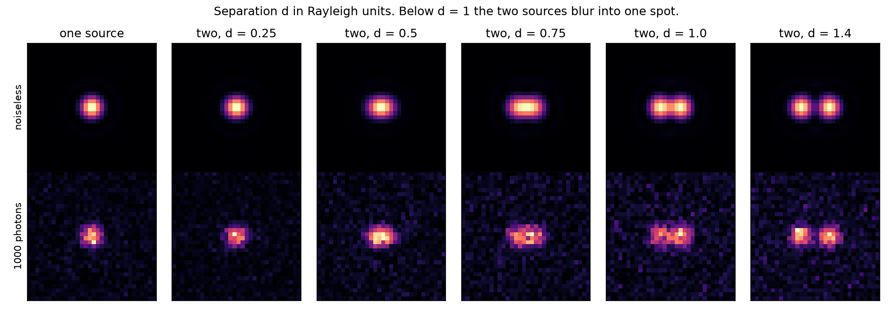
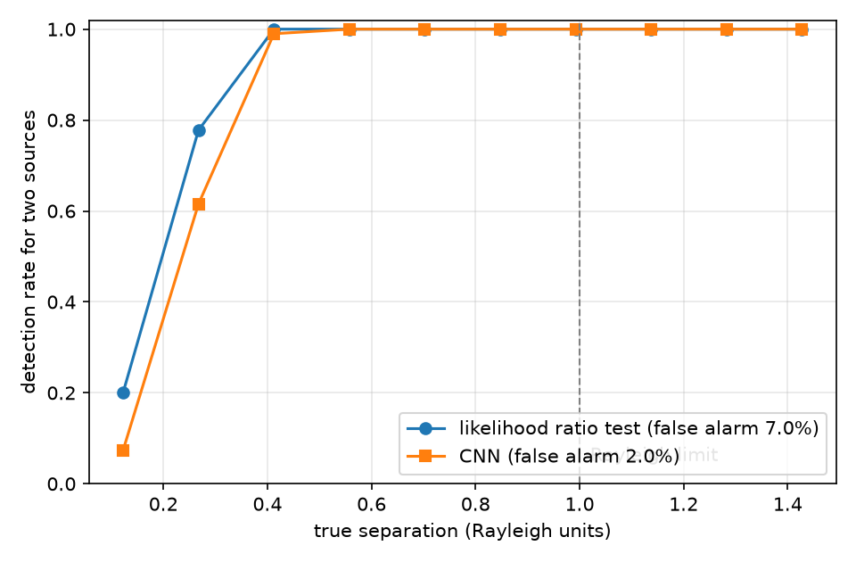
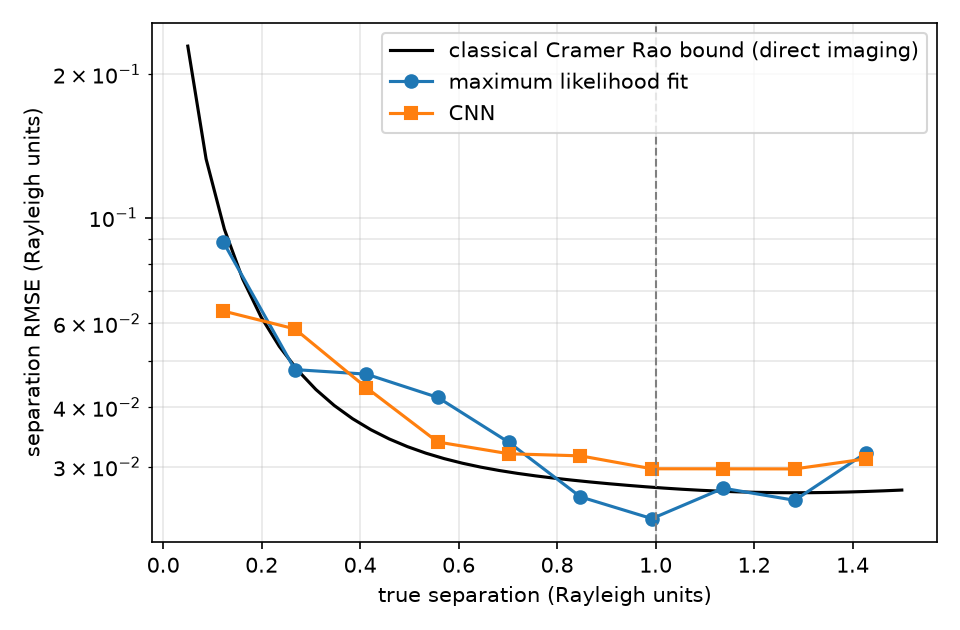

# Resolving Point Sources Below the Rayleigh Limit with a CNN

A small learning project. I wanted to understand the problem behind sub diffraction imaging, so I built a simplified version of it. Can a CNN tell whether a blurry spot is one point source or two, and estimate how far apart they are, even when the separation is below the Rayleigh limit?



## The problem

Every lens blurs a point of light into an Airy pattern. The Rayleigh criterion says two equally bright points are "just resolved" when the center of one sits on the first dark ring of the other. Below that separation, the eye and simple methods see a single blob.

The Rayleigh criterion is a rule of thumb, not a hard law. With a good model of the optics and enough photons, statistics can still pull information out of the blob. The real limit comes from photon noise.

## What this repo does

**Simulator** (`psf.py`). Renders images of one or two incoherent point sources through a circular aperture. It uses the Airy point spread function, integrates light over each pixel, adds background and applies Poisson shot noise. Sources have random position jitter and random orientation.

**Classical baseline** (`baseline_glrt.py`). For each image, fits a one source model and a two source model by Poisson maximum likelihood, then uses the likelihood ratio to decide one vs two. The two source fit also gives a separation estimate. This is the standard approach and the fair bar for the CNN to meet.

**Theoretical limit**. Computes the classical Cramer Rao bound on separation from the Fisher information of the pixel data. No unbiased estimator using direct imaging can beat this curve.

**CNN** (`model.py`, `train.py`). A small convolutional network with two heads, one for one vs two sources and one for separation. Trained on simulated data with flip and rotation augmentation.

## Results so far

Settings are a 32 by 32 pixel image, Rayleigh radius of 5 pixels, 1,000 signal photons and 2 background photons per pixel.

The likelihood ratio test detected two sources almost every time down to about 0.35 Rayleigh units, with a false alarm rate near 7%. Detection fell to about 78% around 0.27 and about 20% around 0.12. Its separation estimates track the Cramer Rao bound closely.




The baseline was evaluated on 250 held out images, so each separation bin holds roughly 25 samples and the curves are noisy. At the smallest separations the fit can dip below the bound because it is biased there, and the bound only applies to unbiased estimators.

CNN results will appear in these plots after running `train.py`.

## What I find most interesting

The separation error explodes as the sources get closer. This is known as Rayleigh's curse. With direct imaging, the Fisher information about separation drops toward zero as the separation shrinks, so no amount of clever processing fixes it. Tsang, Nair and Lu (Physical Review X, 2016) showed that measuring the light in a different basis, such as spatial mode sorting, avoids this curse. That is the gap quantum imaging aims to close, and it shows where a CNN on regular camera images can and cannot help.

So the honest goal for the CNN is not to beat physics. It is to reach the classical bound while running far faster than iterative model fitting, which takes about half a second per image here.

## How to run

```
pip install -r requirements.txt
python test_shapes.py
python baseline_glrt.py --n 500
python train.py --epochs 15 --n-train 60000
python plots.py
```

Training uses a GPU or Apple silicon if available and falls back to CPU.

## Limitations and next steps

This version assumes equal brightness sources, a perfect known aperture, no aberrations and direct intensity imaging only. Next I want to add unequal brightness, random photon counts, simple aberrations and a simulated mode sorting measurement to compare against direct imaging.
